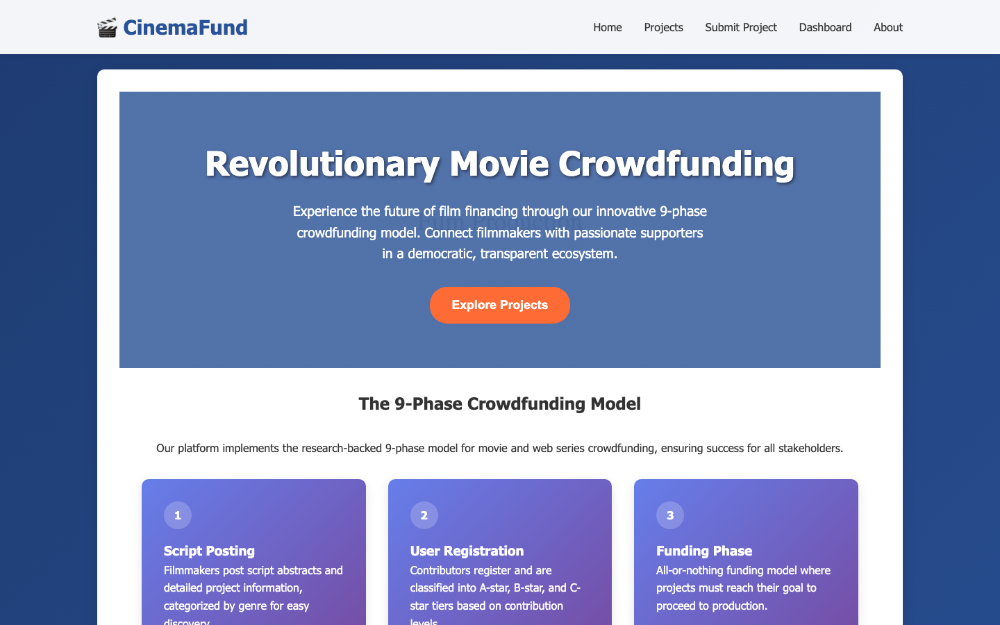
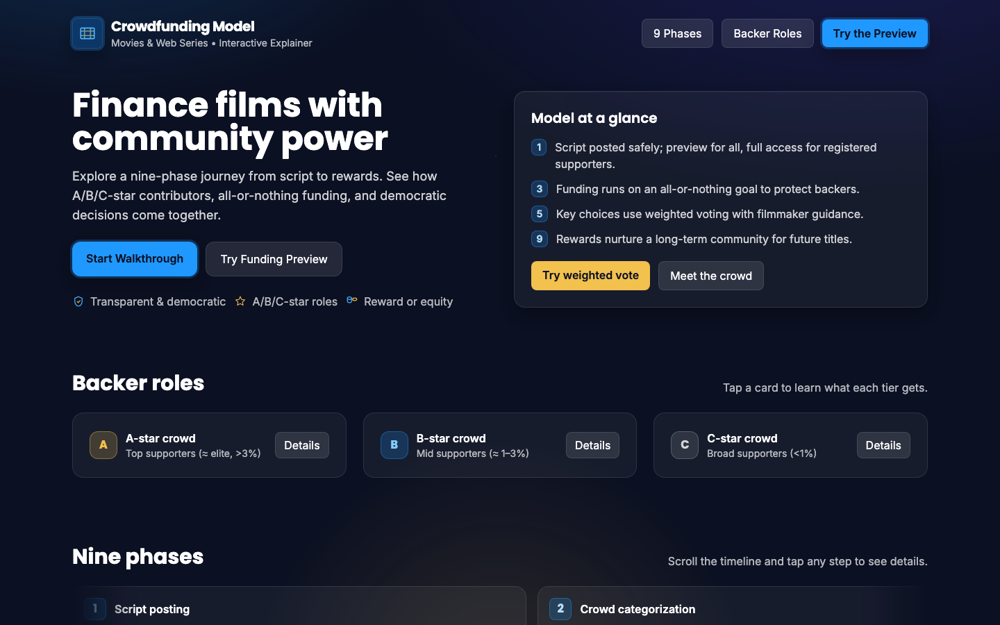

# CinemaFund – Crowdfunding Platform for Movies and Web Series

A web prototype of a **9-phase, reward-based crowdfunding model** for films and web series. Filmmakers post
projects, the crowd funds them, and top backers vote on key creative decisions.

**Live demo:** [Platform](https://srikarasudan.github.io/cinemafund-movie-crowdfunding/) ·
[Interactive model explainer](https://srikarasudan.github.io/cinemafund-movie-crowdfunding/model-explainer.html)




## The problem

Independent filmmakers usually depend on studios, grants or sponsors, and often give up creative control
in return. Crowdfunding lets them raise money directly from their future audience. Generic platforms don't
cover film-specific steps such as script review, casting decisions and distribution.

## The 9-phase model

| # | Phase | What happens |
|---:|---|---|
| 1 | Script posting | Filmmakers post a script abstract and project details, tagged by genre |
| 2 | User registration | Backers sign up and are grouped into tiers by how much they contribute |
| 3 | Funding | **All-or-nothing:** the project goes ahead only if it reaches its goal |
| 4 | Casting | Backers take part in auditions, casting and crew selection |
| 5 | Decision making | The filmmaker and A-star backers decide key production choices together (**weighted voting**) |
| 6 | Fund transfer | Funds are released to the filmmaker once funding and decisions are complete |
| 7 | Distribution | Choosing OTT platforms or other channels, and the marketing strategy |
| 8 | Revenue generation | Revenue sharing and profit distribution under the chosen model |
| 9 | Promotion & rewards | Rewards go to backers, and promotion builds support for future projects |

**Backer tiers**

| Tier | Contribution | What they get |
|---|---|---|
| A-star | More than 3% of the budget | Decision-making power, cast and crew selection, financial tracking, direct cast interaction |
| B-star | 1–3% of the budget | Suggestion rights, limited audition access, progress tracking, on-screen credits |
| C-star | Less than 1% | Project updates, signed merchandise, community and early content access |

## What's in the prototype

**Platform (`index.html`)**
- The 9-phase model and the crowd tier system
- Current projects, filtered by genre and sortable, with *View details* and *Contribute* buttons
- A **Submit your project** form: title, genre, funding goal (₹), duration, description, script abstract and reward tiers
- A backer and filmmaker dashboard showing contributions and projects

**Interactive explainer (`model-explainer.html`)**
- Step-by-step walkthrough of the nine phases and the backer roles
- **Funding and revenue preview:** set the goal, number of backers and average pledge for each tier,
  then compare reward and equity models
- **Weighted voting demo** (e.g. lead actor A vs B, OTT vs theatrical release)
- Distribution and reward plan builder with *copy plan*



## Tech stack

HTML5 · CSS3 · vanilla JavaScript · Tailwind CSS (explainer page). Each page is a single file with no
build step and no backend. Data is sample data held in the browser.

## Run locally

Open `index.html` in any browser, or serve the folder:

```bash
git clone https://github.com/srikarasudan/cinemafund-movie-crowdfunding.git
cd cinemafund-movie-crowdfunding
python3 -m http.server 8000   # then open http://localhost:8000
```

## Documents

- [`docs/report.pdf`](docs/report.pdf): project report (workflow, architecture and comparison with existing platforms)
- [`docs/presentation.pptx`](docs/presentation.pptx): presentation slides

## About

Industrial project, B.Tech. Computer Science & Business Systems, SASTRA Deemed University.
Faculty guide: Dr. Prabaharan L.

**Author:** Srikarasudan P R · [LinkedIn](https://www.linkedin.com/in/srikarasudan-p-r-4b4423212/)
